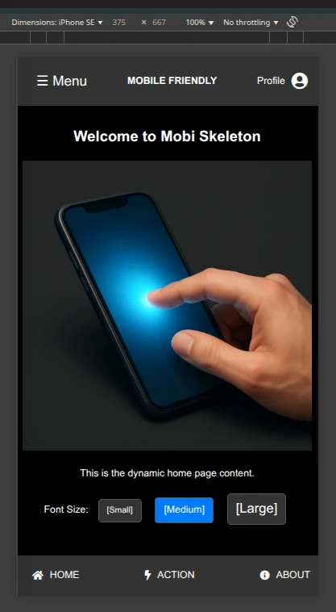

# mobi-skeleton

A mobile-friendly PHP web app skeleton using HTMX, jQuery, plain CSS, and
small file-based modules. It is intended as a reusable starting point for
phone-first sites and simple application prototypes.

## Features

- PHP entry point with modular pages in `mod/*.php`
- HTMX navigation with normal links as a fallback
- jQuery-based menu interactions for older mobile browser support
- Two always-present panels for dynamic mode switching
- Responsive dark theme for phones, tablets, and desktops
- Placeholder account, settings, support, policy, and action pages
- No database layer and no framework assumptions

## Requirements

- PHP 7.x or newer
- Apache, Nginx, or another web server that can serve PHP
- Optional Apache `.htaccess` support for the included hardening rules

## Quick Start

1. Clone or copy this repository into a web-visible directory.
2. Confirm PHP requests are handled by your web server.
3. Open `/index.php` in a browser.
4. Edit `index.php`, `mbstyle.css`, `mobiskel.js`, and the modules under `mod/`.
5. Replace the placeholder artwork, text, terms, privacy policy, and forms for your project.

See [docs/SETUP.md](docs/SETUP.md) for a slightly more detailed setup checklist.

## Panels

The default layout includes two persistent panels:

- `Panel 1` for the primary app surface
- `Panel 2` for secondary/detail content

The panels switch instantly with `mobiskel_show_pane('panel1')` and
`mobiskel_show_pane('panel2')`. Each panel can also be repainted with HTMX when
fresh server-rendered content is needed. See [docs/PANES.md](docs/PANES.md).

## Module Pattern

Each page is selected with the `frm` query parameter. For example:

```text
index.php?frm=contactus
```

That loads:

```text
mod/contactus.php
```

The module should define a matching function:

```php
function contactus() {
    print "<h2>Contact Us</h2>";
} // end func contactus
```

Keep new modules generic until a downstream project is ready to add its own
database, authentication, API, or template layer.

## Included Modules

- `home`, `aboutus`, `contactus`
- `action1`, `action2`
- `settings`, `accountsettings`
- `login`, `logout`, `yourprofile`, `editpicture`
- `support`, `help`, `termsconditions`, `privacypolicy`, `license`

## File Structure

```text
.
|-- index.php
|-- mbstyle.css
|-- mobiskel.js
|-- cfg/
|-- mod/
|   |-- home.php
|   |-- panel2.php
|   |-- settings.php
|   `-- ...
|-- tests/
|-- docs/
`-- img/
```

## Privacy And Secrets

This repository should stay safe to reuse publicly.

Do not commit:

- `.env` files
- real API keys, OAuth secrets, or access tokens
- private hostnames, emails, names, addresses, or client data
- production logs, uploads, media libraries, database dumps, or cache files
- app-specific documentation copied from a private project

Use `.env.example` for placeholder configuration names only. See
[docs/SECURITY.md](docs/SECURITY.md) for the skeleton hardening checklist.

## Development Checks

Run PHP syntax checks before committing PHP changes:

```sh
php -l index.php
for phpfile in mod/*.php tests/*.php; do php -l "$phpfile" || exit 1; done
```

If PHPUnit is installed for your environment, the included input-cleaning test
can be used as a small smoke test.


